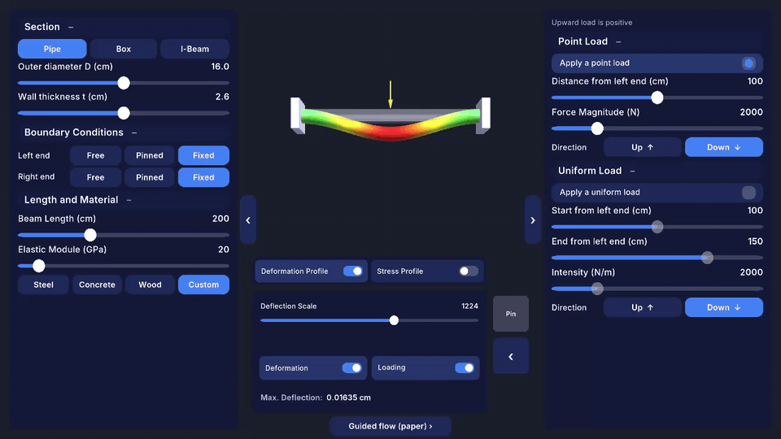
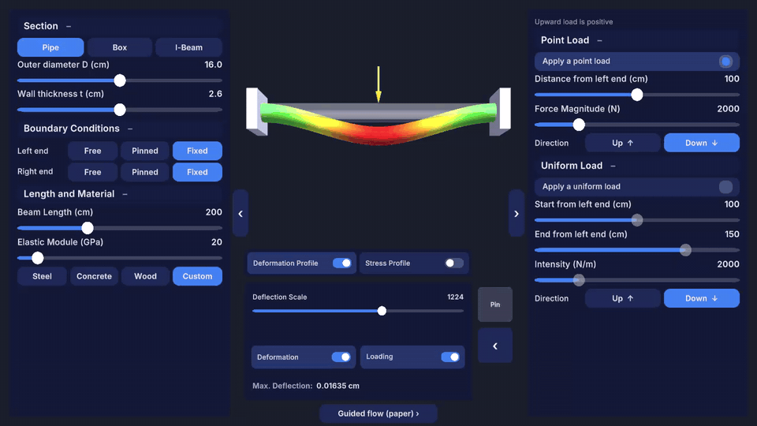
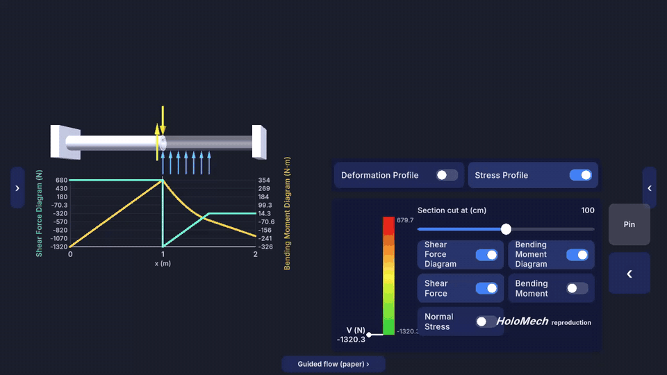
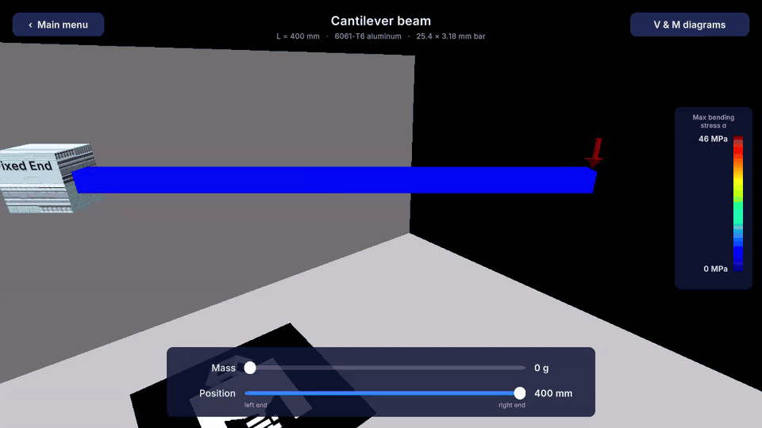
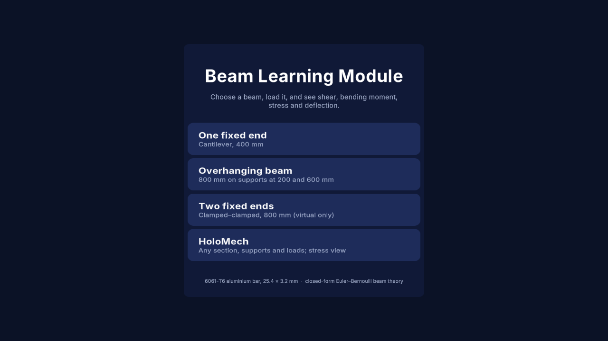
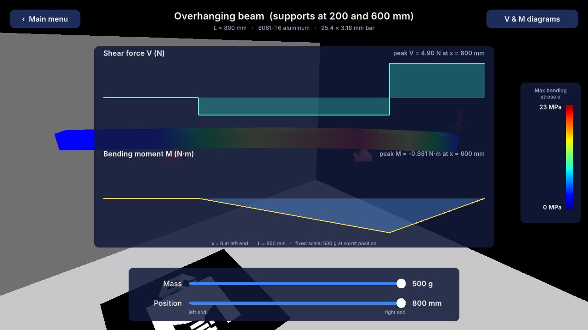
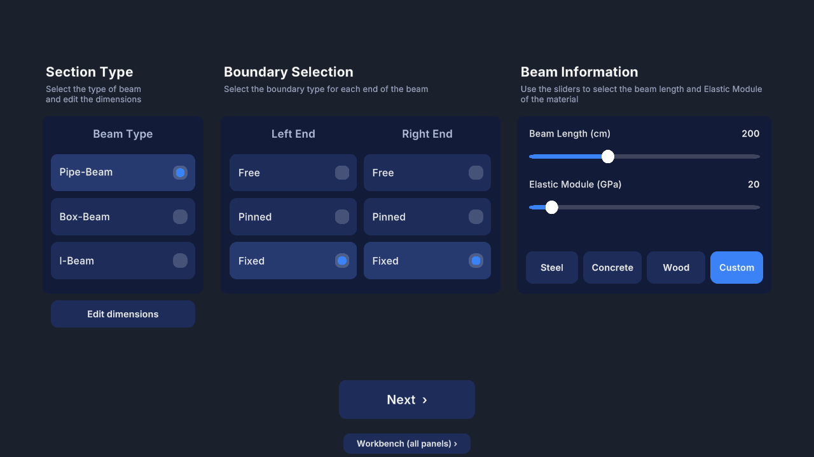
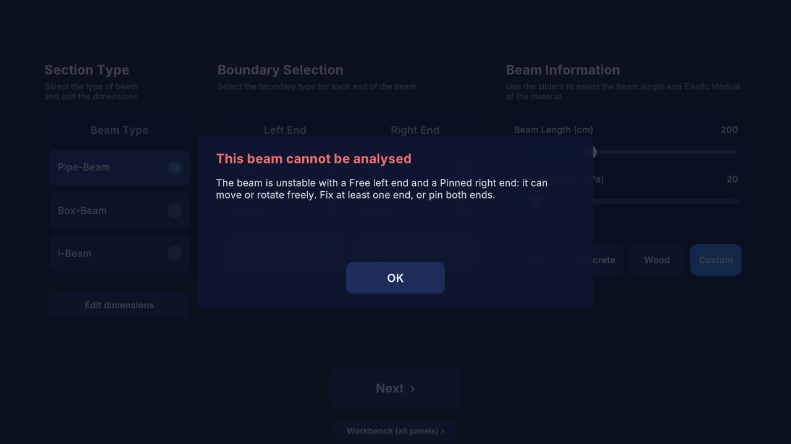
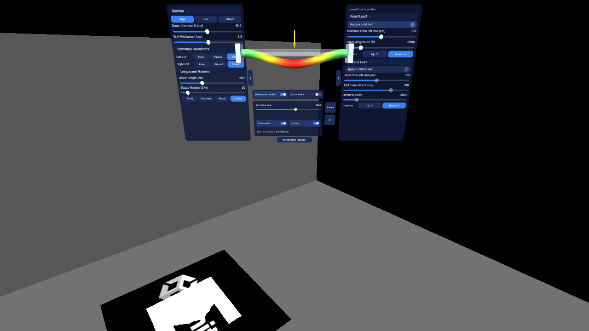

# AR Beam Learning Module

Unity app for teaching shear force, bending moment, stress and deflection in beams. Students load a beam
(sliders today; tracked weights on a physical rig, or hand interaction in a headset, later) and see the
closed-form beam-theory result: the deflected shape, a stress colour map on a fixed scale, the shear-force and
bending-moment diagrams, and the support reactions.

The mechanics are exact Euler–Bernoulli closed-form solutions (Macaulay / singularity functions) for any set of
pin and clamp supports, checked against Hibbeler's beam tables and against an independent stiffness-method solver.
A reproduction of HoloMech (Amouzgar & Mousavi 2025) is being built in `Assets/HoloMech/` on the same solver. Milestones 1–5 are done in the Editor (solver, deflection view, input panels with the stability check, stress view with diagrams and a section cut, mixed-reality presentation); a device build is still open, with two layouts: **Workbench** (all panels on screen, the beam updates while you drag) and **Guided** (the paper's step-by-step flow); the scene is `Assets/HoloMech/Scenes/HoloMech.unity`; rebuild the scene with the menu **HoloMech ▸ Build Scene**.
Change history and design decisions are in [DEVLOG.md](DEVLOG.md).

## Demo

**HoloMech reproduction, Workbench layout.** Every input is on screen; the beam is re-solved while a slider moves
(here the point load travels along a steel pipe fixed at both ends; colour = |deflection|).



**Changing the section and supports.** Pipe → box → I-beam, then cantilever, Pinned–Free (unstable: the banner
explains why and the last valid beam stays), simply supported, an upward uniform load, and back to fixed–fixed.



**Stress profile (paper Fig. 7).** The section cut moves along the beam; the part beyond the cut turns
transparent; the cut shows the shear force, then the bending moment, then the normal-stress distribution, with the
colour-bar pointer reading the value at the cut. Shear (cyan) and moment (yellow) diagrams below share the x axis.



**Original rig scene, now on beam theory.** 6061-T6 bar, 400 mm cantilever: mass 0 → 500 g at the tip, then the
load moves toward the clamp. Deflection is drawn at true δ/L; colour is |M|c/I on a fixed scale (46 MPa = 500 g at
the tip).



| | |
|---|---|
|  |  |
| Main menu | Overhanging beam, 500 g at the tip, live V and M diagrams |
|  |  |
| HoloMech Guided layout (the paper's flow), Scene 2 | Free–Pinned supports: the app refuses and explains |
|  | |
| HoloMech XR scene in the Editor (XR Simulation): the panels on a world-space board, the beam hologram in front | |

The GIFs are recorded with Unity Recorder (`HoloMech ▸` scripts `DemoDriver` + `DemoRecorder`, 30 fps MP4 →
ffmpeg → GIF), so they show the real UI being driven, not mock-ups.

## Requirements

| | |
|---|---|
| Unity | **6000.5.3f1** (Unity 6.5). The project was upgraded from 2022.3.62f3 on 2026-10-19. |
| Key packages | AR Foundation / ARCore / ARKit 6.5.0, XR Interaction Toolkit 3.5.1, URP 17.5.0, Input System 1.19.0, Test Framework 1.7.0, uGUI 2.5.0 (includes TextMesh Pro) |
| Optional | `com.unity.pipeline` (lets the [Unity CLI](https://unity.com) drive the open Editor); .NET 8 SDK to run the solver tests without Unity |
| Quest 3 | Meta XR Core SDK, Meta XR Interaction SDK and its OVR integration (Building Blocks) 207.0.1, OpenXR 1.18.0 |
| Device builds | Android Build Support with OpenJDK, SDK and NDK r27c (per machine, see [Quest 3](#quest-3)). The active platform is **Android**; the active build profile is **Android Quest 3**. |

## Scenes

All in `Assets/_ARMarker/Scenes/`. Open `MainMenu.unity` and press Play.

| Scene | Menu button | Beam | Script on the beam |
|---|---|---|---|
| `BeamScene 1.unity` | One fixed end | Cantilever, L = 400 mm, clamped at the left | `CantileverBeam` |
| `BeamScene 2.unity` | Overhanging beam | L = 800 mm, pin at 200 mm, roller at 600 mm | `OverhangBeam` |
| `BeamScene.unity` | Two fixed ends | L = 800 mm, clamped at both ends (virtual only) | `BeamBend` |

All three use the bench-rig bar: 6061-T6 aluminium, 1" × 1/8" (25.4 × 3.175 mm), E = 68.9 GPa.
The mass slider is 0–500 g; the position slider runs from the left end (0) to the right end (1).
The **Shear Force & Bending Moment Diagram** button toggles a live diagram panel.

## UI

All four screens share one look (`Assets/ARBeam/UI/UiTheme.asset`): Inter Regular / Medium / SemiBold / Bold
(SIL OFL, licence next to the fonts), navy translucent rounded panels, white text, blue accent; shear cyan and
moment yellow in the diagrams, as in HoloMech. Canvases use a 1920×1080 reference with match 0.5, and every
element is anchored to its edge or corner, so the layout holds at any window size or aspect ratio.

On a desktop (Editor Play mode with XR Simulation, or a PC build) `DesktopPreviewFraming` moves the XR Origin so the
whole beam is in view from the side, clear of the top bar, control panel and legend, and re-frames when the window
is resized. On phones and headsets it does nothing.

Editor tools (menu **ARBeam ▸ UI**), both re-runnable:

- **Build Theme Assets** (`UiThemeBuilder`): static TMP font assets for the four weights (pre-filled with ASCII,
  Greek and the unit / arrow symbols the UI uses, so Play mode never rewrites them), the rounded-rectangle and
  circle sprites, and the theme asset.
- **Restyle All Scenes** (`BeamUiStyler`): lays out and styles the main menu and the three beam scenes, then runs
  `BeamSceneSetup`. CLI: `unity command eval -- --code "return BeamUiStyler.StyleAllScenes();" --timeout 240000`

## How it fits together

```
 Load sources                 Model + solver                        Views
 ─────────────                ──────────────                        ─────
 SliderLoadSource  ─┐                                          ┌─▶ BeamMeshView        (deflected shape + stress colours)
 InspectorLoadSource├─▶ BeamController ──▶ BeamSolver.Solve ──▶├─▶ BeamDiagramGraphic  (V and M diagrams, uGUI)
 (marker / hand,    │    beam params,        (pure C#)         ├─▶ StressLegendLabel   (legend in MPa)
  to be written)   ─┘    fixed scales,                         └─▶ SliderLoadSource    (arrow, readouts)
                         scene ↔ beam mapping
```

| Folder | Assembly | What is in it |
|---|---|---|
| `Assets/ARBeam/Mechanics/` | `ARBeam.Mechanics` (`noEngineReferences: true`) | `BeamModel`, `BeamSection` (rectangle, pipe, box, I), `BeamMaterial`, `PointLoad`, `UniformLoad`, `BeamSupports` (named layouts, per-end Free/Pinned/Fixed, or any support list), `BeamSolver`, `BeamSolution`, `BeamResult`. No Unity dependency; the compiler enforces it. |
| `Assets/ARBeam/Runtime/` | `ARBeam.Runtime` | MonoBehaviours: `BeamController`, `BeamLoadSource` (+ `SliderLoadSource`, `InspectorLoadSource`), `BeamMeshView`, `BeamDiagramGraphic`, `StressLegendLabel`, `SliderDrivenBeam`. |
| `Assets/ARBeam/Editor/` | Assembly-CSharp-Editor | `BeamSceneSetup`: menu **ARBeam ▸ Set Up Beam Scenes** wires the three scenes. Idempotent. |
| `Assets/ARBeam/Tests/EditMode/` | `ARBeam.Mechanics.Tests` | 105 NUnit tests (see below). |
| `Assets/HoloMech/Model/` | `HoloMech.Model` (`noEngineReferences: true`) | `HoloMechInputs`: the HoloMech panels' values (cm, N, N/m, GPa, upward positive) and their conversion to an SI `BeamModel`. |
| `Assets/HoloMech/View/` | `HoloMech.View` | Scene 4 view: `HoloMechBeamView` (grey reference beam, deflected beam coloured by \|w\|, supports, load arrows), `BeamMeshBuilder` (section extrusion, 240 stations), `DeformationPanel`, `UiKit` (themed controls from code); Mixed reality: `XRPresentation` (world-space board, LazyFollow pin); demos: `DemoDriver`; Workbench layout: `WorkbenchLayout` (collapsible side panels, live re-solve, problem banner); Guided layout: `BeamInfoScreen` (Scene 2), `DimensionsPopup` (2.a–c, live cross-section preview), `LoadingScreen` (Scene 3), `ErrorPopup`; Scene 5: `StressProfileView` (3D V and M diagrams, section cut with shear arrow / moment arc / σ profile) and `StressPanel` (cut slider, colour bar and pointer, five switches); `HoloMechApp` is the state controller. |
| `Assets/HoloMech/Tests/EditMode/` | `HoloMech.Tests` | 16 tests: unit and sign conversion, section outlines vs section properties. |
| `Assets/*.cs` | Assembly-CSharp | The original scripts. `CantileverBeam`, `OverhangBeam`, `BeamBend` are now thin subclasses of `SliderDrivenBeam`, kept so the scenes' slider events still resolve. `DiagramPopup` toggles the live panel. |
| `Tools/SolverTests/` | — | .NET project that compiles the solver and its tests outside Unity. |

### Using the solver directly

```csharp
using ARBeam.Mechanics;

var bar = BeamSection.Rectangular(0.0254, 0.003175);                  // b, h in metres
var model = new BeamModel(0.8, bar, BeamMaterial.Aluminum6061T6.ElasticModulus,
                          BeamSupports.Overhang(0.2, 0.6));
model.PointLoads.Add(PointLoad.FromMass(0.8, 0.5));                   // 500 g at the right tip
var s = BeamSolver.Solve(model);

s.Reactions;              // [R_A = −2.45 N at 0.2 m, R_B = 7.35 N at 0.6 m]
s.Moment(0.6);            // −0.981 N·m
s.Deflection(0.8);        // −8.40e-3 m
s.MaxBendingStress;       // 2.30e7 Pa
s.Diagram(BeamQuantity.Shear);   // polyline with vertical steps at point loads
s.Sample(16);                    // BeamResult: arrays x, V, M, θ, w, σmax on the same grid

// Any end conditions; a mechanism is reported instead of solved:
var propped = new BeamModel(2.0, BeamSection.Pipe(0.16, 0.026), 200e9,
                            BeamSupports.Ends(EndCondition.Fixed, EndCondition.Pinned));
BeamSolver.TrySolve(propped, out var solution, out string error);   // error != null for Free–Pinned etc.
```

### Conventions

- **Units:** SI inside the solver (m, N, Pa). The Inspector uses mm, g and MPa for readability.
- **x** runs from the beam's left end (0) to the right end (L).
- **Signs (Hibbeler):** loads positive downward; V = sum of upward forces left of the section; M positive when
  sagging; θ and v positive upward. A beam loaded by gravity has v < 0. Diagrams draw positive values upward.
- **Reactions:** force positive upward, moment positive counter-clockwise on the beam.
- **Shear and moment jump** at point loads (and M at clamps). `Shear(x)`/`Moment(x)` return the right-hand limit
  (left-hand limit at x = L); `ShearLeft`/`ShearRight` when the side matters.
- **Self-weight** is off by default (`BeamController.includeSelfWeight`). When on, it is added to V, M, σ and the
  reactions; the drawn deflection is always relative to the unloaded beam, because the real bar already sags under
  its own weight.
- **Deflection amplification** (`BeamMeshView`): 1 means the drawn δ/L equals the real δ/L. The beam's scene length
  maps to the real length, so a 1:1 AR overlay uses amplification 1.
- **Fixed colour and diagram scales:** full scale is the design mass (500 g) at its worst position on that beam,
  computed once per configuration. Nothing is renormalised per frame, so colour and diagram height mean the same
  thing for every load. Override the stress scale with `stressScaleOverrideMPa`.

### Adding another input (marker-tracked weights, hand interaction)

Subclass `BeamLoadSource`, report loads in beam coordinates, and call `NotifyChanged()` when they change.
`BeamController.WorldToBeamX` projects a tracked world position onto the beam axis, and `SetAxisWorld` aligns the
axis with two tracked points (for example markers at the beam ends).

```csharp
public class MarkerLoadSource : ARBeam.BeamLoadSource
{
    public override void CollectLoads(ARBeam.BeamController beam, List<PointLoad> loads)
    {
        foreach (var hanger in stableHangers)   // e.g. only after 0.5 s without movement
            loads.Add(PointLoad.FromMass(beam.WorldToBeamX(hanger.position), hanger.massKg));
    }
}
```

Put it on the beam object (or a child) and it is picked up automatically, or add it with
`BeamController.AddLoadSource`.

## Tests

121 EditMode tests.

`Assets/ARBeam/Tests/EditMode/` (105):

- **HibbelerTableTests**: R. C. Hibbeler, *Mechanics of Materials* (10th ed.), Appendix C: cantilever (end load,
  midspan load, full and half UDL) and simply supported (central and off-centre load, full and half UDL),
  checking v_max, θ, the elastic curve, reactions and M_max. Exact formulas agree to 1e-9; the two tabulated
  four-figure coefficients (0.006563 wL⁴/EI at 0.4598 L) to the project's 1 % criterion.
- **OverhangAndFixedTests**: overhang by superposition of Appendix C cases; fixed–fixed from Gere & Goodno
  Appendix H / Roark Table 8.1.
- **GeneralSupportTests**: the HoloMech spec §3.5 acceptance cases (< 0.5 %) through the per-end API, including
  a propped cantilever and a cantilever clamped on the right; stability of all nine Free/Pinned/Fixed end pairs;
  a two-span continuous beam; and agreement with **StiffnessReferenceSolver** (direct stiffness method, Hermite
  elements, used only in tests) for every stable end pair, an overhang and a three-support beam, to 1e-6.
- **SectionTests**: A, I, c of rectangle, hollow box, pipe and I-section against hand calculation.
- **BenchRigTests**: the numbers in the rig plan (22.4 / 11.2 / 8.4 mm, 46 / 23 MPa for 500 g).
- **SolverPropertyTests**: equilibrium, dM/dx = V and dv/dx = θ, support conditions, superposition, peak
  finding against dense sampling, diagram steps, input validation.

`Assets/HoloMech/Tests/EditMode/` (16): cm/GPa → SI, "upward is positive" → solver sign, material buttons,
section dimensions, unstable supports and bad loads reported before solving; extrusion outlines (box, I, pipe)
have the same area and I as the section properties the solver uses; dependent section limits.

Run them in **Window ▸ General ▸ Test Runner ▸ EditMode**, or without Unity:

```
dotnet test Tools/SolverTests
```

or against the open Editor with the Unity CLI:

```
unity command run_tests -- --mode EditMode --filter ARBeam.Mechanics.Tests --filter_type assembly
unity command run_tests -- --mode EditMode --filter HoloMech.Tests --filter_type assembly
```

## Mixed reality and devices (HoloMech milestone 5)

`Assets/HoloMech/Scenes/HoloMechXR.unity` runs the same app in world space (`XRPresentation`): the panels sit on a
board about 2 m wide, 2.6 m in front of the user, with the beam hologram (0.7 m) in front of the board's free centre.
UI input goes through XRI (`XRUIInputModule` + `TrackedDeviceGraphicRaycaster`), so phone touch (the AR rig's
screen-space ray interactor) and headset rays or pokes both work; nothing depends on MRTK. **Pin** toggles XRI's
`LazyFollow`: pinned, the board stays put; **Follow**, it drifts back in front of the user. The main menu's
**HoloMech** button loads `HoloMech` on a PC and `HoloMechXR` on a phone or headset.

In the Editor, press Play in `HoloMechXR`: XR Simulation provides the camera (right mouse + WASD to move).

### Quest 3

`Assets/HoloMech/Scenes/HoloMechQuest.unity` is the headset version, built from Meta's **Building Blocks** and
**UI Set** by **HoloMech ▸ Build Quest Scene** (`HoloMechQuestSceneBuilder`):

| Part | What it is |
|---|---|
| Camera Rig | `OVRCameraRig` + `OVRManager` (Building Block) |
| Interactions Rig | Interaction SDK rig: hands and controllers, ray, poke, grab, locomotion (Building Block) |
| Passthrough | `OVRPassthroughLayer` underlay: the app is mixed reality, the room stays visible (Building Block) |
| Board | World-space canvas, 1.8 m wide, 1.6 m in front of the user, with Meta's ray and poke canvas interaction (Interaction SDK Quick Actions) and `PointableCanvasModule` |
| Controls | Meta Horizon OS **UI Set** prefabs: grey buttons, toggle tiles for choices, switches, check boxes, sliders (`MetaUiSkin` asset in `Assets/HoloMech/Quest/`) |
| Theme | `UiTheme_Quest.asset`: the shared theme with Quest system colours (neutral dark plates, Meta blue) |

The panels' code is unchanged: `UiKit` builds each control from the UI Set prefab when `UiKit.Skin` is set
(`HoloMechApp.uiSkin`), and from its own drawing otherwise, so the PC and student scenes keep the Inter theme.
Board placement, Pin / Follow and the beam hologram (0.5 m on Quest) are the same `XRPresentation` as above.
In Editor Play mode without a headset, `HoloMechXR` still runs under XR Simulation (see the loader order below).

Project settings for Quest (done): platform Android; XR Plug-in Management → Android: **OpenXR** only (ARCore off),
with the Meta XR feature, Meta Quest support, and the Oculus Touch / Touch Plus / hand interaction profiles; Meta's
Project Setup Tool fixes applied (Linear colour space, minimum API 32, ASTC, GameActivity, passthrough support,
hands and controllers, and so on). Editor Play mode uses the Standalone settings: OpenXR (Quest Link) when a headset
is connected through Link, otherwise XR Simulation, so the PC scenes behave as before.

To build: plug in the Quest 3 (developer mode on, USB debugging allowed in the headset), **File ▸ Build Profiles ▸
Android Quest 3 ▸ Build And Run**. The profile (`Assets/Settings/Build Profiles/Android Quest 3.asset`) has its own
scene list with `HoloMechQuest` first (the other scenes follow, unchanged; the global list is untouched) and ASTC
texture compression. Android Build Support, OpenJDK, SDK and NDK r27c are installed per machine
(`unity install-modules -e 6000.5.3f1 -m android android-sdk-ndk-tools android-open-jdk-17.0.18+8 --cm`); on one
machine the NDK could not be extracted under `Program Files` and was unpacked by hand, with its path set in
**Preferences ▸ External Tools ▸ Android NDK**.

To run from the Editor on the headset (Play mode over Quest Link or Air Link): the Meta Horizon Link app must be the
active OpenXR runtime and the headset in Link. Standalone XR loaders are **OpenXR first, XR Simulation second**, so
Play uses the headset when Link is up and falls back to XR Simulation otherwise. For passthrough and hands over Link,
turn on **Developer Runtime Features** and **Passthrough over Meta Quest Link** in the Link app (Settings ▸ Beta).

Phones (ARCore) can still use `HoloMechXR`; re-enable ARCore under XR Plug-in Management → Android first.

Runtime materials (arrows, supports, diagram lines, the ghost beam) copy templates from
`Assets/HoloMech/Resources/HoloMechMaterials/` (**HoloMech ▸ Build Runtime Materials**), so a player build keeps the
URP Lit / Unlit shader variants they need.

## Re-running the scene setup

`BeamSceneSetup` sets the beam parameters, adds the components, sets the mass slider to 0–500 g, builds the live
diagram panel next to the old PNG popup (the PNG is kept, unused), and moves the overhang supports to 200/600 mm.
Run it from **ARBeam ▸ Set Up Beam Scenes**, or from the CLI:

```
unity command eval -- --code "return BeamSceneSetup.SetUpAllScenes();" --timeout 120000
```

## Not done yet

- On-device test of `HoloMechQuest` (the APK builds; install and test on the headset still open).
- Cross-check against the Python package IndeterminateBeam (Bonanno 2021).
- Load input from tracked weight markers (rig option B) or hand interaction (headset option A).
- A simply supported scene (the solver and tests already cover it).
- AR placement of the virtual beam on a phone.
