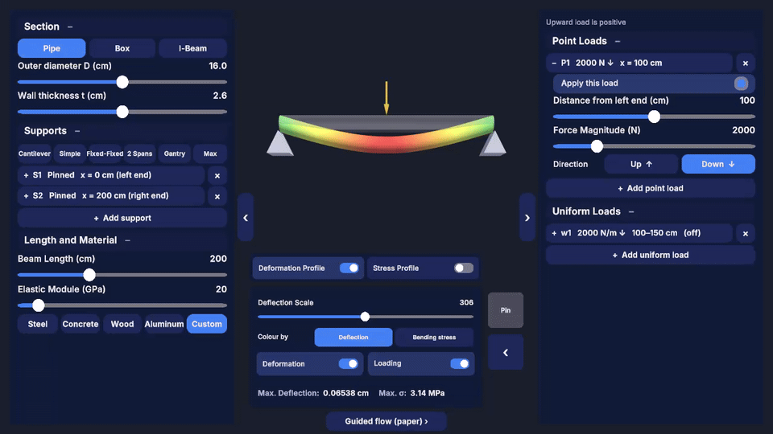
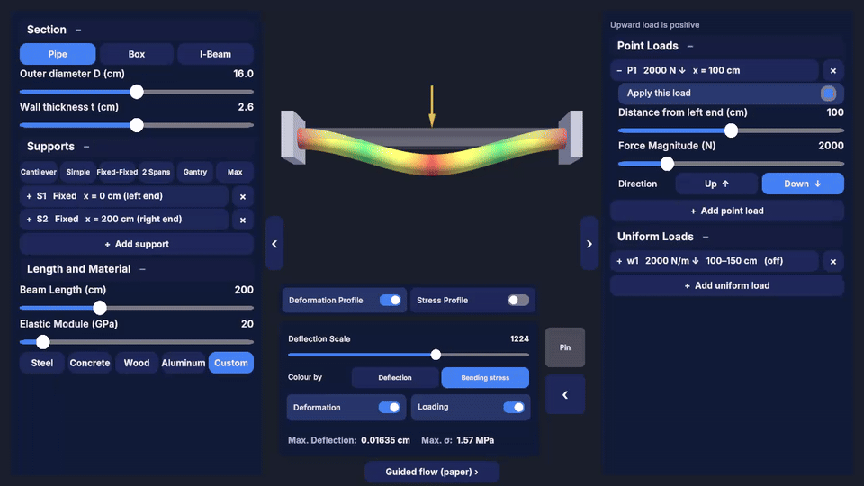
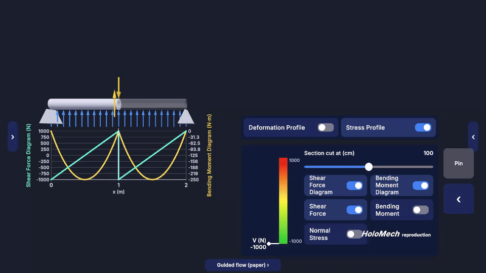
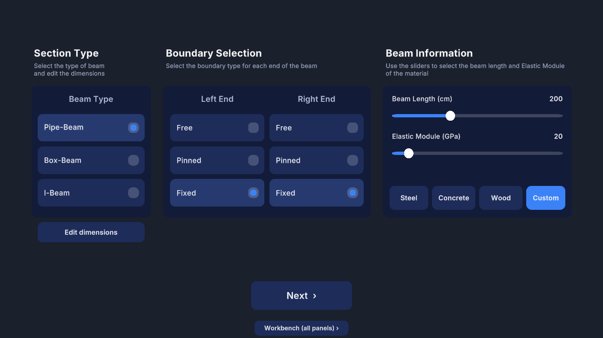
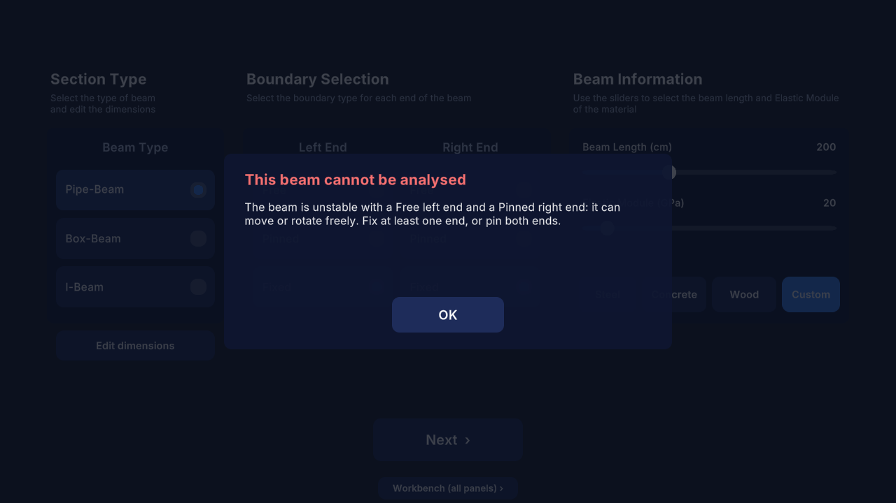
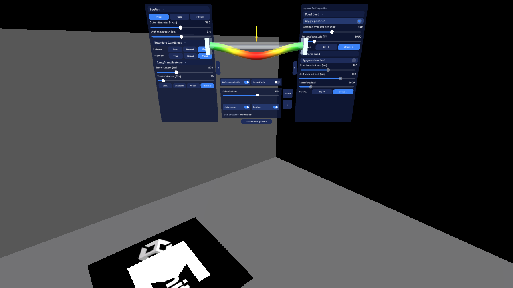

# AR Beam Learning Module

Mixed-reality beam analysis for Meta Quest 3 / 3S. The user sets up a beam (length, section, material, any number of point loads, uniform loads and pin or clamp supports) and sees the closed-form beam-theory result in the room: the deflected shape, a bending-stress colour map on a fixed scale, the shear-force and bending-moment diagrams, and the support reactions. In on-site mode the virtual beam is laid at 1:1 scale onto a real structural member (two-point controller alignment, then nudges), so the colours and diagrams appear on the member under simulated loads.

The mechanics are exact Euler–Bernoulli closed-form solutions (Macaulay / singularity functions) for any set of pin and clamp supports, checked against Hibbeler's beam tables, an independent stiffness-method solver and IndeterminateBeam (`Tools/SolverCrossCheck/`). The interface follows HoloMech (Amouzgar & Mousavi 2025), rebuilt on this solver, in two layouts: **Workbench** (all panels on screen, the beam updates while you drag) and **Guided** (the paper's step-by-step flow).

Release v1.0.0 is archived on Zenodo: [10.5281/zenodo.24206301](https://doi.org/10.5281/zenodo.24206301). Video demo on the headset: <https://youtu.be/WrtzLXeWMVE>. Change history and design decisions are in [DEVLOG.md](DEVLOG.md).

## Demo

**HoloMech reproduction, Workbench layout.** Every input is on screen; the beam is re-solved while a slider moves
(here the point load travels along a steel pipe fixed at both ends; colour = |deflection|).



**Changing the section and supports.** Pipe → box → I-beam, then cantilever, Pinned–Free (unstable: the banner
explains why and the last valid beam stays), simply supported, an upward uniform load, and back to fixed–fixed.



**Stress profile (paper Fig. 7).** The section cut moves along the beam; the part beyond the cut turns
transparent; the cut shows the shear force, then the bending moment, then the normal-stress distribution, with the
colour-bar pointer reading the value at the cut. Shear (cyan) and moment (yellow) diagrams below share the x axis.



| | |
|---|---|
|  |  |
| HoloMech Guided layout (the paper's flow), Scene 2 | Free–Pinned supports: the app refuses and explains |
|  | |
| HoloMech XR scene in the Editor (XR Simulation): the panels on a world-space board, the beam hologram in front | |

The GIFs are recorded with Unity Recorder (`HoloMech ▸` scripts `DemoDriver` + `DemoRecorder`, 30 fps MP4 →
ffmpeg → GIF), so they show the real UI being driven, not mock-ups.

## Requirements

| | |
|---|---|
| Unity | **6000.5.3f1** (Unity 6.5). The project was upgraded from 2022.3.62f3 on 2026-10-19. |
| Key packages | AR Foundation / ARCore / ARKit 6.5.0, XR Interaction Toolkit 3.5.1, URP 17.5.0, Input System 1.19.0, Test Framework 1.7.0, uGUI 2.5.0 (includes TextMesh Pro) |
| Optional | `com.unity.pipeline` (lets the [Unity CLI](https://unity.com) drive the open Editor); .NET 8 SDK to run the solver tests without Unity |
| Quest 3 | Meta XR Core SDK, Meta XR Interaction SDK and its OVR integration (Building Blocks) 207.0.1, OpenXR 1.18.0 |
| Device builds | Android Build Support with OpenJDK, SDK and NDK r27c (per machine, see [Quest 3](#quest-3)). The active platform is **Android**; the active build profile is **Android Quest 3**. |

## Scenes

All in `Assets/HoloMech/Scenes/`. `HoloMechQuest.unity` is the Meta Quest 3 / 3S mixed-reality app (the build
profile **Android Quest 3** builds only this scene); `HoloMech.unity` and `HoloMechXR.unity` are the desktop and XR
Editor versions. The beam surface uses `Assets/HoloMech/Materials/BeamVertexColor.mat` (shader
`HoloMech/VertexColorLit`), which shows the per-vertex deflection or bending-stress colours.

The scenes and scripts of the earlier student prototype (`Assets/_ARMarker`, the scripts in the `Assets` root and
their material) were removed on 2026-11-13 and are not part of this software.

## UI

The desktop and XR Editor scenes use one theme (`Assets/ARBeam/UI/UiTheme.asset`): Inter Regular / Medium / SemiBold / Bold (SIL OFL, licence next to the fonts), navy translucent rounded panels, white text, blue accent; shear cyan and moment yellow in the diagrams, as in HoloMech. The Quest scene uses Meta's UI Set instead (see [Quest 3](#quest-3)).

Menu **ARBeam ▸ UI ▸ Build Theme Assets** (`UiThemeBuilder`, re-runnable) builds static TMP font assets for the four weights (pre-filled with ASCII, Greek and the unit / arrow symbols the UI uses, so Play mode never rewrites them), the rounded-rectangle and circle sprites, and the theme asset.

## How it fits together

```
 HoloMech panels (Workbench / Guided / Quest window / on-site card)
        │  HoloMechInputs: cm, N, N/m, GPa, upward positive
        ▼
 BeamModel (SI) ──▶ BeamSolver.Solve (pure C#, ARBeam.Mechanics) ──▶ BeamSolution
        │                                                                │
        ▼                                                                ▼
 SitePlacement (1:1 pose on a real member)        HoloMechBeamView (deflected shape + stress colours),
                                                  StressProfileView (V and M diagrams, section cut)
```

| Folder | Assembly | What is in it |
|---|---|---|
| `Assets/ARBeam/Mechanics/` | `ARBeam.Mechanics` (`noEngineReferences: true`) | `BeamModel`, `BeamSection` (rectangle, pipe, box, I), `BeamMaterial`, `PointLoad`, `UniformLoad`, `BeamSupports` (named layouts, per-end Free/Pinned/Fixed, or any support list), `BeamSolver`, `BeamSolution`, `BeamResult`. No Unity dependency; the compiler enforces it. |
| `Assets/ARBeam/Runtime/` | `ARBeam.Runtime` | `UiTheme` (used by the HoloMech desktop scenes). The other MonoBehaviours (`BeamController`, `BeamLoadSource`, `BeamMeshView`, `BeamDiagramGraphic`, ...) are a generic slider-driven beam component; no scene in this release uses them. |
| `Assets/ARBeam/Editor/` | Assembly-CSharp-Editor | `UiThemeBuilder` (see [UI](#ui)). |
| `Assets/ARBeam/Tests/EditMode/` | `ARBeam.Mechanics.Tests` | Solver tests (see below). |
| `Assets/HoloMech/Model/` | `HoloMech.Model` (`noEngineReferences: true`) | `HoloMechInputs`: the HoloMech panels' values (cm, N, N/m, GPa, upward positive) and their conversion to an SI `BeamModel`. `SiteAdjust`: the on-site card's mm steps. `SiteSnapshot`: a snapshot's CSV row and JSON. |
| `Assets/HoloMech/View/` | `HoloMech.View` | Scene 4 view: `HoloMechBeamView` (grey reference beam, deflected beam coloured by \|w\|, supports, load arrows), `BeamMeshBuilder` (section extrusion, 240 stations), `DeformationPanel`, `UiKit` (themed controls from code); Mixed reality: `XRPresentation` (world-space board, LazyFollow pin); Quest window: `XRWindowLayout`, `FaceUserGrabTransformer`, `GrabHandleVisual`; demos: `DemoDriver`; Workbench layout: `WorkbenchLayout` (collapsible side panels, live re-solve, problem banner); Guided layout: `BeamInfoScreen` (Scene 2), `DimensionsPopup` (2.a–c, live cross-section preview), `LoadingScreen` (Scene 3), `ErrorPopup`; Scene 5: `StressProfileView` (3D V and M diagrams, section cut with shear arrow / moment arc / σ profile) and `StressPanel` (cut slider, colour bar and pointer, five switches); `HoloMechApp` is the state controller. |
| `Assets/HoloMech/Tests/EditMode/` | `HoloMech.Tests` | Unit and sign conversion, section outlines vs section properties, multiple loads and supports, on-site steps, Gantry and Max presets, controller stick input, snapshots. |
| `Assets/HoloMech/Tests/PlayMode/` | `HoloMech.PlayTests` | Tests that open the real scenes and press their buttons, and the render tests for the paper figures. |
| `Tools/SolverTests/` | — | .NET project that compiles the solver and its tests outside Unity. |
| `Tools/SolverCrossCheck/` | — | Solver verification cases (`cases.json`) checked against closed form, the stiffness reference and IndeterminateBeam 2.4.0 (`crosscheck.py`). |

### Using the solver directly

```csharp
using ARBeam.Mechanics;

var bar = BeamSection.Rectangular(0.0254, 0.003175);                  // b, h in metres
var model = new BeamModel(0.8, bar, BeamMaterial.Aluminum6061T6.ElasticModulus,
                          BeamSupports.Overhang(0.2, 0.6));
model.PointLoads.Add(PointLoad.FromMass(0.8, 0.5));                   // 500 g at the right tip
var s = BeamSolver.Solve(model);

s.Reactions;              // [R_A = −2.45 N at 0.2 m, R_B = 7.35 N at 0.6 m]
s.Moment(0.6);            // −0.981 N·m
s.Deflection(0.8);        // −8.40e-3 m
s.MaxBendingStress;       // 2.30e7 Pa
s.Diagram(BeamQuantity.Shear);   // polyline with vertical steps at point loads
s.Sample(16);                    // BeamResult: arrays x, V, M, θ, w, σmax on the same grid

// Any end conditions; a mechanism is reported instead of solved:
var propped = new BeamModel(2.0, BeamSection.Pipe(0.16, 0.026), 200e9,
                            BeamSupports.Ends(EndCondition.Fixed, EndCondition.Pinned));
BeamSolver.TrySolve(propped, out var solution, out string error);   // error != null for Free–Pinned etc.
```

### Conventions

- **Units:** SI inside the solver (m, N, Pa). The Inspector uses mm, g and MPa for readability.
- **x** runs from the beam's left end (0) to the right end (L).
- **Signs (Hibbeler):** loads positive downward; V = sum of upward forces left of the section; M positive when
  sagging; θ and v positive upward. A beam loaded by gravity has v < 0. Diagrams draw positive values upward.
- **Reactions:** force positive upward, moment positive counter-clockwise on the beam.
- **Shear and moment jump** at point loads (and M at clamps). `Shear(x)`/`Moment(x)` return the right-hand limit
  (left-hand limit at x = L); `ShearLeft`/`ShearRight` when the side matters.
## Tests

`Assets/ARBeam/Tests/EditMode/`:

- **HibbelerTableTests**: R. C. Hibbeler, *Mechanics of Materials* (10th ed.), Appendix C: cantilever (end load,
  midspan load, full and half UDL) and simply supported (central and off-centre load, full and half UDL),
  checking v_max, θ, the elastic curve, reactions and M_max. Exact formulas agree to 1e-9; the two tabulated
  four-figure coefficients (0.006563 wL⁴/EI at 0.4598 L) to the project's 1 % criterion.
- **OverhangAndFixedTests**: overhang by superposition of Appendix C cases; fixed–fixed from Gere & Goodno
  Appendix H / Roark Table 8.1.
- **GeneralSupportTests**: the HoloMech spec §3.5 acceptance cases (< 0.5 %) through the per-end API, including
  a propped cantilever and a cantilever clamped on the right; stability of all nine Free/Pinned/Fixed end pairs;
  a two-span continuous beam; and agreement with **StiffnessReferenceSolver** (direct stiffness method, Hermite
  elements, used only in tests) for every stable end pair, an overhang and a three-support beam, to 1e-6.
- **SectionTests**: A, I, c of rectangle, hollow box, pipe and I-section against hand calculation.
- **BenchRigTests**: the numbers in the rig plan (22.4 / 11.2 / 8.4 mm, 46 / 23 MPa for 500 g).
- **SolverPropertyTests**: equilibrium, dM/dx = V and dv/dx = θ, support conditions, superposition, peak
  finding against dense sampling, diagram steps, input validation.

`Assets/HoloMech/Tests/EditMode/`: cm/GPa → SI, "upward is positive" → solver sign, material buttons,
section dimensions, unstable supports and bad loads reported before solving; extrusion outlines (box, I, pipe)
have the same area and I as the section properties the solver uses; dependent section limits; on-site mm steps and
the 1000 cm on-site limit; the Gantry preset and its support and trolley rows; snapshot CSV rows; the JSON round trip
to the same σmax and vmax.

`Assets/HoloMech/Tests/PlayMode/`: `WorkbenchListsPlayTest` (desktop scene; it waits for rendered frames, so run
it from the Test Runner window, not under `-batchmode`) and `SiteCardPlayTest` (Quest scene, no headset needed: the
on-site card's buttons, with the anchor buttons grey). Spatial anchors themselves can only be tested on a headset.

Run them in **Window ▸ General ▸ Test Runner ▸ EditMode**, or without Unity:

```
dotnet test Tools/SolverTests
```

or against the open Editor with the Unity CLI:

```
unity command run_tests -- --mode EditMode --filter ARBeam.Mechanics.Tests --filter_type assembly
unity command run_tests -- --mode EditMode --filter HoloMech.Tests --filter_type assembly
```

## Mixed reality and devices (HoloMech milestone 5)

`Assets/HoloMech/Scenes/HoloMechXR.unity` runs the same app in world space (`XRPresentation`): the panels sit on a
board about 2 m wide, 2.6 m in front of the user, with the beam hologram (0.7 m) in front of the board's free centre.
UI input goes through XRI (`XRUIInputModule` + `TrackedDeviceGraphicRaycaster`), so phone touch (the AR rig's
screen-space ray interactor) and headset rays or pokes both work; nothing depends on MRTK. **Pin** toggles XRI's
`LazyFollow`: pinned, the board stays put; **Follow**, it drifts back in front of the user.
In the Editor, press Play in `HoloMechXR`: XR Simulation provides the camera (right mouse + WASD to move).

### Quest 3

`Assets/HoloMech/Scenes/HoloMechQuest.unity` is the headset version, built from Meta's **Building Blocks** and
**UI Set** by **HoloMech ▸ Build Quest Scene** (`HoloMechQuestSceneBuilder`):

| Part | What it is |
|---|---|
| Camera Rig | `OVRCameraRig` + `OVRManager` (Building Block) |
| Interactions Rig | Interaction SDK rig: hands and controllers, ray, poke, grab, locomotion (Building Block) |
| Passthrough | `OVRPassthroughLayer` underlay: the app is mixed reality, the room stays visible (Building Block) |
| Window | `XRWindowLayout`: the whole app in one window, 1.8 m wide, 1.6 m in front of the user, centred 8 cm below eye height. Grab the pill-shaped handle under it (hand, controller or ray) to move it in 3D; the beam and all panels are children and move with it. The Beam panel, Load panel and result menu each have their own canvas and a handle on top: pull them anywhere, also outside the window. Anything moved keeps facing the user (`FaceUserGrabTransformer`, an Interaction SDK transformer). **Reset Layout** on the window bar puts the panels and the beam back and brings the window in front of the user. Every canvas has Meta's ray and poke canvas interaction, every handle Meta's grab and ray grab (Quick Actions); grabbing the window switches Follow to Pinned |
| Controls | Meta Horizon OS **UI Set** prefabs: grey buttons, toggle tiles for choices, switches, check boxes, sliders (`MetaUiSkin` asset in `Assets/HoloMech/Quest/`) |
| Theme | `UiTheme_Quest.asset`: the shared theme with Quest system colours (neutral dark plates, Meta blue) |

The panels' code is unchanged: `UiKit` builds each control from the UI Set prefab when `UiKit.Skin` is set
(`HoloMechApp.uiSkin`), and from its own drawing otherwise, so the PC and student scenes keep the Inter theme.
Board placement, Pin / Follow and the beam hologram (0.5 m on Quest) are the same `XRPresentation` as above.
In Editor Play mode without a headset, `HoloMechXR` still runs under XR Simulation (see the loader order below).

Project settings for Quest (done): platform Android; XR Plug-in Management → Android: **OpenXR** only (ARCore off),
with the Meta XR feature, Meta Quest support, and the Oculus Touch / Touch Plus / hand interaction profiles; Meta's
Project Setup Tool fixes applied (Linear colour space, minimum API 32, ASTC, GameActivity, passthrough support,
hands and controllers, and so on). Editor Play mode uses the Standalone settings: OpenXR (Quest Link) when a headset
is connected through Link, otherwise XR Simulation, so the PC scenes behave as before.

To build: plug in the Quest 3 (developer mode on, USB debugging allowed in the headset), **File ▸ Build Profiles ▸
Android Quest 3 ▸ Build And Run**. The profile (`Assets/Settings/Build Profiles/Android Quest 3.asset`) has its own
scene list with `HoloMechQuest` first (the other scenes follow, unchanged; the global list is untouched) and ASTC
texture compression. Android Build Support, OpenJDK, SDK and NDK r27c are installed per machine
(`unity install-modules -e 6000.5.3f1 -m android android-sdk-ndk-tools android-open-jdk-17.0.18+8 --cm`); on one
machine the NDK could not be extracted under `Program Files` and was unpacked by hand, with its path set in
**Preferences ▸ External Tools ▸ Android NDK**.

To run from the Editor on the headset (Play mode over Quest Link or Air Link): the Meta Horizon Link app must be the
active OpenXR runtime and the headset in Link. Standalone XR loaders are **OpenXR first, XR Simulation second**, so
Play uses the headset when Link is up and falls back to XR Simulation otherwise. For passthrough and hands over Link,
turn on **Developer Runtime Features** and **Passthrough over Meta Quest Link** in the Link app (Settings ▸ Beta).

Phones (ARCore) can still use `HoloMechXR`; re-enable ARCore under XR Plug-in Management → Android first.

Runtime materials (arrows, supports, diagram lines, the ghost beam) copy templates from
`Assets/HoloMech/Resources/HoloMechMaterials/` (**HoloMech ▸ Build Runtime Materials**), so a player build keeps the
URP Lit / Unlit shader variants they need.

### On-site overlay

On the Quest, the **On-site Overlay (MR)** card in the Beam panel lays the beam onto a real member at true scale
(`SitePlacement`). The colours show bending stress under simulated loads; the label above the beam says so.

- **Place it:** grab the handle above the beam, or **Align by 2 points**, then nudge.
- **Dimensions:** beam length and the current section's dimensions in mm, with − / + and a 1 mm, 5 mm or 1 cm step. On-site, the
  length can reach 10 m; past the sliders' 5 m the Workbench slider stays at its end and the inputs hold the value. The section
  type is still chosen in the Workbench.
- **Gantry preset** (Workbench, Supports): the lab gantry girder as measured on 2026-11-13: aluminium I-beam (E = 68.9 GPa), 160 × 85 mm, flanges 14 mm (parallel-flange model), web 6 mm, length 2438.4 mm, pins at 152.4 and 2286.0 mm, one 4450 N point load (the trolley) at midspan. On-site it adds rows for the left support, right support and trolley, so they can be moved to the measured positions. Two-point alignment still means the ends of the beam, not the legs. The legs
  and trolley are not drawn: the real ones are right there.
- **Save placement** keeps the beam's place and inputs across app starts with one Meta spatial anchor; pressing it again replaces
  the old one, and **Forget placement** erases it. Next time on-site mode is turned on, the beam goes back there, or the status says it
  could not be found (another room, or the headset lost its space map) and the beam stays in front of the user. There are no
  anchors in the Editor or over Link, so these buttons are grey there.

### On-site records

In on-site mode the Quest app writes to its persistent data folder, `/sdcard/Android/data/com.unity.template.ar_mobile/files/`:

| File | Written | What it is |
|---|---|---|
| `alignment_log.csv` | each two-point alignment | The touched points, for the registration-accuracy trials. Its format stays as it is. |
| `site_snapshots.csv` | **Save snapshot** (`trigger = manual`), each two-point alignment (`align`), each **Save placement** (`anchor_save`) | One row per snapshot: dimensions, supports, loads, pose, anchor and result. |
| `snapshots/site_snapshot_<UTC time>.json` | with each row | The complete inputs, for loading and solving again. |
| `anchors.json` | **Save placement** | The saved anchor's UUID and the inputs at that moment, same format as the JSON above. |

Copy them to the PC:

```
adb pull /sdcard/Android/data/com.unity.template.ar_mobile/files/ .
```

Reading `site_snapshots.csv`:

- Units are in the column names; numbers use a decimal point in every locale. Columns of other section types are empty.
- `preset` is the Workbench preset last pressed (`Gantry`, `Simple`, ...); adding, deleting or retyping a support makes it `Custom`.
- `supports` is `kind@x_m`, `point_loads` is `P_N@x_m`, `udls` is `w_Npm@a_m-b_m`, each separated by semicolons. Loads have the
  solver's sign (downward positive) and loads switched off are left out.
- **The loads are simulated.** `sigma_max_MPa` and `v_max_mm` are the solution for those loads, not measurements. `v_max_mm` has
  the solver's sign (upward positive). The four result columns are empty if the beam could not be solved.
- `pos_x`, `pos_y`, `pos_z` and `yaw_deg` are the beam's left end in world coordinates and its angle about the vertical. The world
  origin moves with each app start, so they are only comparable within one session; across sessions, use the anchor.

## Not done yet

- Quest: depth occlusion (real objects in front of the beam or panels should hide them), with Meta's Depth API
  (`EnvironmentDepthManager` and occlusion shaders for the beam materials and the UI). Planned, not started.
- Loads from real weights (tracked markers or load cells) instead of simulated loads.
- AR placement of the virtual beam on a phone.

## License

MIT, see [LICENSE](LICENSE). Unity packages, samples and the bundled fonts keep their own licenses.
